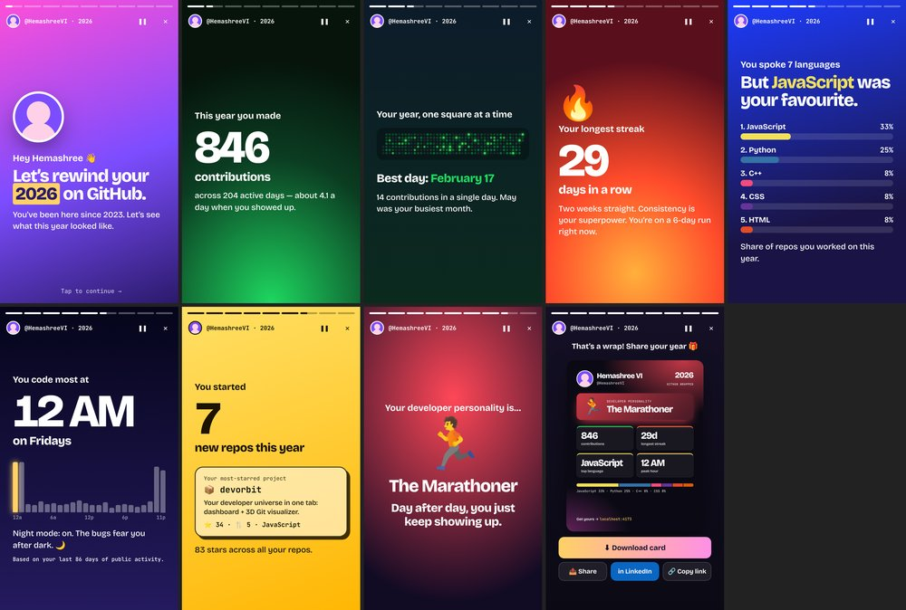
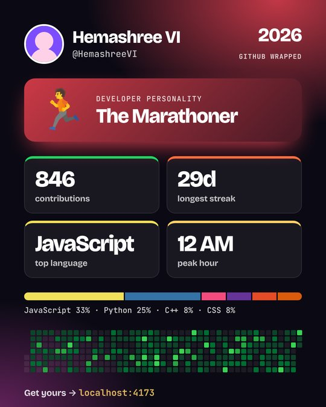

# GitHub Wrapped 🎁

**Your year in code, as a Spotify-Wrapped-style story.** Type any GitHub username and get an animated, tap-through story of the year: contributions, streaks, top languages, the hour you code most, and your **developer personality**. At the end you get a share card made for LinkedIn and Instagram.

**Live:** https://hemashreevi.github.io/github-wrapped/  ·  Share yours: `…/github-wrapped/?u=your-username`


<sub>Screenshots use sample data.</sub>

No login, no backend and no API key. Everything runs in your browser.

## The story

| # | Slide | What it shows |
|---|---|---|
| 1 | **Intro** | Your avatar and how long you've been on GitHub |
| 2 | **Contributions** | Your total for the year, counting up, plus your average per active day |
| 3 | **Heatmap** | Your contribution calendar animating in, your best day and your busiest month |
| 4 | **Streak** 🔥 | Your longest run of consecutive days, and your current streak |
| 5 | **Languages** | Your top 5 languages with animated bars |
| 6 | **Rhythm** | The hour and weekday you code most, as a 24-hour bar chart |
| 7 | **Repos** | New repos this year and your most-starred project |
| 8 | **Personality** | One of 9 archetypes (see below) |
| 9 | **Share card** | A 1080×1350 PNG to download, with share, LinkedIn and copy-link buttons |

Slides without data are skipped, so a brand-new account still gets a clean story.



### Developer personalities
Each archetype is scored against a threshold, and the strongest one wins:

- 🦉 **Night Owl**: 35%+ of activity between 10 PM and 5 AM
- 🌅 **Early Bird**: 30%+ between 5 and 10 AM
- 🏃 **Marathoner**: a streak of 14+ days
- 🌍 **Polyglot**: 5+ languages
- 🏗️ **Builder**: 8+ new repos
- ⭐ **Rising Star**: 50+ stars
- 🛡️ **Weekend Warrior**: 40%+ of activity on weekends
- 🤝 **Collaborator**: 35%+ PRs, reviews and comments
- 🌱 **Explorer**: everyone else, just getting started

<br clear="right" />

### Controls
Tap the right side to go forward and the left side to go back. **Hold** to pause. On a keyboard, use ← → to move, Space to pause and Esc to exit.

## Where the data comes from

| Data | Source |
|---|---|
| Profile, repos, languages, stars | GitHub REST API (`/users/:u`, `/users/:u/repos`) |
| Coding hours, weekdays, activity mix | GitHub public events API, which covers roughly the last 90 days and 300 events |
| Contribution calendar and streaks | [github-contributions-api](https://github.com/grubersjoe/github-contributions-api) (public, CORS-enabled) |

Results are cached in `localStorage` for an hour. GitHub allows 60 unauthenticated requests per hour per IP, and one wrap uses about 6. If you hit the limit, paste a token with **no scopes** to raise it to 5,000. The token stays in `sessionStorage` and is only sent to GitHub.

## Tech

React 19 + Vite · plain CSS animations · [html-to-image](https://github.com/bubkoo/html-to-image) for the PNG card · Web Share API on mobile · GitHub Pages.

All the number-crunching lives in [`src/lib/stats.js`](src/lib/stats.js) as pure functions, which makes it easy to test:

```
computeWrapped({ user, repos, events, calendar, year }) → { cal, langs, repos, rhythm, persona }
```

## Run locally

```bash
npm install
npm run dev      # http://localhost:5173
npm test         # unit tests for the stats engine
npm run build
```

## Deploy

Push to `main`, then set **Settings → Pages → Source → GitHub Actions**. The workflow in `.github/workflows/deploy.yml` tests, builds and publishes the site. `vite.config.js` uses a relative base, so it works under any repo name.

## Project structure

```
src/
  App.jsx                 landing → loading → story; ?u= deep links
  lib/github.js           API calls, pagination, caching, errors
  lib/stats.js            pure stats + personality engine
  components/Landing.jsx  search page
  components/Story.jsx    story player (progress bars, tap/hold/keys)
  components/slides.jsx   the slides
  components/ShareCard.jsx 1080×1350 card + download/share actions
tests/stats.test.js
```

---

Built by [Hema](https://github.com/HemashreeVI) · Byte Decoded on YouTube. Not affiliated with GitHub or Spotify.
